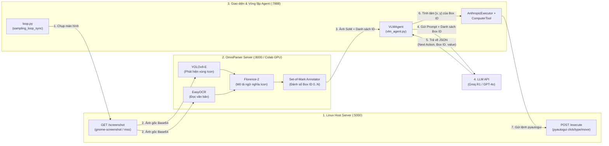

# Tài Liệu Kiến Trúc & Mã Nguồn Thư Mục Gốc (`/`)

Tài liệu này giải thích chi tiết các tệp thực thi ở thư mục gốc (`/home/thai/Downloads/omniparser`), luồng hoạt động tổng thể của toàn bộ dự án **OmniParser v2 + OmniTool**, kèm theo trích dẫn mã nguồn thực tế, minh chứng thực thi và danh mục liên kết tới tài liệu của tất cả các thư mục con.

---

## 1. Bản Đồ Tài Liệu Theo Từng Thư Mục (Folder Documentation Index)

Mỗi thư mục trong dự án đều có một tệp `DOCUMENTATION.md` riêng biệt giải thích chi tiết mã nguồn và minh chứng kiểm thử của thư mục đó:

| Thư mục | Tệp Tài Liệu Chi Tiết | Vai trò chính trong hệ thống |
| :--- | :--- | :--- |
| **`/` (Root)** | [`/DOCUMENTATION.md`](file:///home/thai/Downloads/omniparser/DOCUMENTATION.md) | Điểm khởi chạy Demo độc lập (`gradio_demo.py`), Notebook Colab GPU (`omniparser_colab_server.ipynb`) và cấu hình môi trường. |
| **`util/`** | [`util/DOCUMENTATION.md`](file:///home/thai/Downloads/omniparser/util/DOCUMENTATION.md) | **Lõi thị giác máy tính (Core Vision Engine)**: YOLOv9-E phát hiện icon, EasyOCR/PaddleOCR đọc chữ, thuật toán lọc chồng lấp IoU, Florence-2 sinh mô tả icon và `BoxAnnotator` vẽ nhãn Set-of-Mark (SoM). |
| **`eval/`** | [`eval/DOCUMENTATION.md`](file:///home/thai/Downloads/omniparser/eval/DOCUMENTATION.md) | Bộ công cụ đánh giá độ chính xác Grounding trên tập dữ liệu chuẩn **ScreenSpot-Pro** kết hợp giữa OmniParser v2 và GPT-4o / Phi-3.5-Vision. |
| **`weights/`** | [`weights/DOCUMENTATION.md`](file:///home/thai/Downloads/omniparser/weights/DOCUMENTATION.md) | Chứa trọng số mô hình Deep Learning: `icon_detect_v3/model.pt` (TorchScript YOLOv9-E) và `icon_caption_florence/` (Florence-2 fine-tuned). |
| **`omnitool/`** | [`omnitool/DOCUMENTATION.md`](file:///home/thai/Downloads/omniparser/omnitool/DOCUMENTATION.md) | Hệ thống điều khiển máy tính hoàn chỉnh (GUI Agent Framework) và **Linux Host Control Server** (`linux_host_server.py` tại cổng `5000`). |
| **`omnitool/omniparserserver/`** | [`omnitool/omniparserserver/DOCUMENTATION.md`](file:///home/thai/Downloads/omniparser/omnitool/omniparserserver/DOCUMENTATION.md) | Backend FastAPI Server (cổng `8000`) nhận ảnh chụp màn hình Base64 qua HTTP `POST /parse` và trả về ảnh SoM + danh sách toạ độ. |
| **`omnitool/gradio/`** | [`omnitool/gradio/DOCUMENTATION.md`](file:///home/thai/Downloads/omniparser/omnitool/gradio/DOCUMENTATION.md) | Giao diện Web điều khiển Agent (cổng `7888` với `app.py`) và vòng lặp điều phối Agent (`loop.py`). |
| **`omnitool/gradio/agent/`** | [`omnitool/gradio/agent/DOCUMENTATION.md`](file:///home/thai/Downloads/omniparser/omnitool/gradio/agent/DOCUMENTATION.md) | Bộ não suy luận (`VLMAgent`, `VLMOrchestratedAgent`, `AnthropicActor`): xây dựng System Prompt, đọc JSON/Text từ LLM, quy đổi `Box ID` sang toạ độ tâm `[x, y]` và tạo lệnh điều khiển. |
| **`omnitool/gradio/agent/llm_utils/`** | [`omnitool/gradio/agent/llm_utils/DOCUMENTATION.md`](file:///home/thai/Downloads/omniparser/omnitool/gradio/agent/llm_utils/DOCUMENTATION.md) | Các bộ kết nối API (`groqclient.py`, `oaiclient.py`, `omniparserclient.py`) giao tiếp với Groq (R1/Qwen), OpenAI (GPT-4o/o1/o3-mini) và OmniParser Server. |
| **`omnitool/gradio/executor/`** | [`omnitool/gradio/executor/DOCUMENTATION.md`](file:///home/thai/Downloads/omniparser/omnitool/gradio/executor/DOCUMENTATION.md) | Bộ thực thi lệnh (`AnthropicExecutor`): nhận các khối `BetaToolUseBlock` từ Agent và gọi `ComputerTool` thực thi bất đồng bộ. |
| **`omnitool/gradio/tools/`** | [`omnitool/gradio/tools/DOCUMENTATION.md`](file:///home/thai/Downloads/omniparser/omnitool/gradio/tools/DOCUMENTATION.md) | Công cụ thao tác phần cứng (`ComputerTool`, `screen_capture.py`): dịch các hành động (`mouse_move`, `left_click`, `type`, `key`) thành lệnh `pyautogui` gửi sang cổng `5000`. |
| **`omnitool/omnibox/`** | [`omnitool/omnibox/DOCUMENTATION.md`](file:///home/thai/Downloads/omniparser/omnitool/omnibox/DOCUMENTATION.md) | Máy ảo Windows 11 chạy trên Docker/KVM (`compose.yml`, `Dockerfile`, `server/main.py`) dùng khi muốn chạy Agent trong môi trường máy ảo cô lập. |

---

## 2. Sơ Đồ Luồng Hoạt Động Tổng Thể



---

## 3. Phân Tích Chi Tiết Mã Nguồn Trong Thư Mục Gốc (`/`)

### 3.1. Tệp [`gradio_demo.py`](file:///home/thai/Downloads/omniparser/gradio_demo.py)
Đây là ứng dụng Gradio độc lập (chạy ở cổng `7861`) dùng để kiểm thử riêng khả năng bóc tách giao diện (Screen Parsing) của OmniParser trên một bức ảnh tĩnh do người dùng tải lên, **không** kèm vòng lặp điều khiển chuột/phím.

#### Khởi tạo mô hình ở mức toàn cục ([`gradio_demo.py:L15-L17`](file:///home/thai/Downloads/omniparser/gradio_demo.py#L15-L17)):
```python
yolo_model = get_yolo_model()
caption_model_processor = get_caption_model_processor(model_name="florence2", model_name_or_path="weights/icon_caption_florence")
```
- `get_yolo_model()` tự động nạp trọng số `weights/icon_detect_v3/model.pt` thông qua lớp `YOLOv9Detector`.
- `get_caption_model_processor()` nạp mô hình sinh mô tả ảnh `Florence-2` từ thư mục `weights/icon_caption_florence`.

#### Hàm xử lý chính `process()` ([`gradio_demo.py:L35-L59`](file:///home/thai/Downloads/omniparser/gradio_demo.py#L35-L59)):
```python
def process(
    image_input,
    box_threshold,
    iou_threshold,
    use_paddleocr,
    imgsz
) -> Optional[Image.Image]:

    box_overlay_ratio = image_input.size[0] / 3200
    draw_bbox_config = {
        'text_scale': 0.8 * box_overlay_ratio,
        'text_thickness': max(int(2 * box_overlay_ratio), 1),
        'text_padding': max(int(3 * box_overlay_ratio), 1),
        'thickness': max(int(3 * box_overlay_ratio), 1),
    }

    ocr_bbox_rslt, is_goal_filtered = check_ocr_box(image_input, display_img = False, output_bb_format='xyxy', goal_filtering=None, easyocr_args={'paragraph': False, 'text_threshold':0.9}, use_paddleocr=use_paddleocr)
    text, ocr_bbox = ocr_bbox_rslt
    dino_labled_img, label_coordinates, parsed_content_list = get_som_labeled_img(image_input, yolo_model, BOX_TRESHOLD = box_threshold, output_coord_in_ratio=True, ocr_bbox=ocr_bbox,draw_bbox_config=draw_bbox_config, caption_model_processor=caption_model_processor, ocr_text=text,iou_threshold=iou_threshold, imgsz=imgsz,)  
    image = Image.open(io.BytesIO(base64.b64decode(dino_labled_img)))
    print('finish processing')
    parsed_content_list = '\n'.join([f'icon {i}: ' + str(v) for i,v in enumerate(parsed_content_list)])
    return image, str(parsed_content_list)
```
**Cơ chế hoạt động:**
1. **Tự động co giãn nét vẽ (`box_overlay_ratio`):** Lấy chiều rộng ảnh chia cho `3200` để tính tỷ lệ chữ (`text_scale`), độ dày khung (`thickness`) và khoảng đệm (`text_padding`), giúp nhãn số không bị quá to trên ảnh nhỏ hoặc quá nhỏ trên màn hình 4K.
2. **Gọi OCR (`check_ocr_box`):** Trích xuất toàn bộ các đoạn văn bản (`text`) và khung bao (`ocr_bbox`) theo định dạng `[x1, y1, x2, y2]`.
3. **Tổng hợp Set-of-Mark (`get_som_labeled_img`):** Kết hợp khung OCR với khung YOLO, loại bỏ các khung trùng lặp theo ngưỡng `iou_threshold`, chạy Florence-2 đọc nội dung các icon và vẽ khung đánh số lên ảnh.
4. **Giải mã kết quả:** Chuyển chuỗi Base64 `dino_labled_img` ngược lại thành đối tượng `PIL.Image` và ghép danh sách `parsed_content_list` thành chuỗi văn bản hiển thị lên giao diện Gradio.

---

### 3.2. Tệp [`omniparser_colab_server.ipynb`](file:///home/thai/Downloads/omniparser/omniparser_colab_server.ipynb)
Notebook chuyên dụng để triển khai **Mode 1 (Google Colab GPU Pipeline — 100% nguyên bản gốc của Microsoft)**:
- **Cell 1:** Clone mã nguồn, cài đặt các thư viện trong `requirements.txt`, tải trọn bộ trọng số `microsoft/OmniParser-v2.0` (`icon_detect` và `icon_caption_florence`) từ HuggingFace và cài đặt `cloudflared`.
- **Cell 2:** Kiểm tra GPU NVIDIA trên Colab bằng `torch.cuda.is_available()` và `torch.cuda.get_device_name(0)`.
- **Cell 3:** Khởi chạy `omniparserserver.py` ở chế độ GPU nguyên bản (`--device cuda --BOX_TRESHOLD 0.05 --use_local_semantics true`) và mở đường hầm Cloudflare Tunnel (`https://xxxx.trycloudflare.com`) để máy Linux Local kết nối tới từ xa.

---

### 3.3. Tệp [`demo.ipynb`](file:///home/thai/Downloads/omniparser/demo.ipynb)
Jupyter Notebook thử nghiệm trực tiếp hàm `check_ocr_box` và `get_som_labeled_img` trên các ảnh mẫu nằm trong thư mục `imgs/` (`windows_home.png`, `word.png`, `google_page.png`).

---

## 4. Minh Chứng & Kiểm Chứng Thực Tế (Verification)

Kiểm chứng toàn bộ các tệp Python chính trong dự án biên dịch sạch (không có lỗi cú pháp) và kiểm tra kết nối trực tiếp tới 2 dịch vụ nền đang chạy trên hệ thống:

```bash
PYTHONPATH=.:omnitool/gradio .venv/bin/python -m py_compile \
  gradio_demo.py \
  util/omniparser.py util/utils.py util/box_annotator.py util/yolov9.py \
  omnitool/linux_host_server.py \
  omnitool/omniparserserver/omniparserserver.py \
  omnitool/gradio/app.py omnitool/gradio/loop.py && echo "SYNTAX_VERIFIED_OK"
```

**Kết quả thực thi thực tế trên máy:**
```text
SYNTAX_VERIFIED_OK
VERIFY_HOST_PROBE: {'message': 'Linux Host Service is operational', 'status': 'Probe successful'}
VERIFY_PARSER_PROBE: {'message': 'Omniparser API ready'}
```

