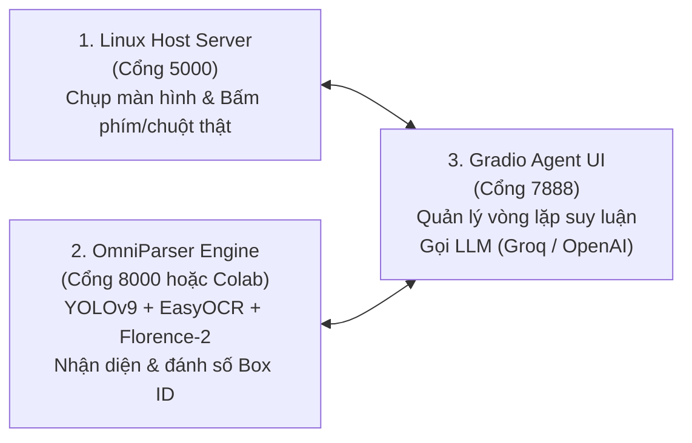

# 🚀 Hướng Dẫn Cài Đặt (Setup) & Vận Hành OmniParser + OmniTool Từ A-Z

Tài liệu này hướng dẫn đầy đủ từ **cài đặt môi trường**, **tải model weights**, đến **cách chạy 2 chế độ (Google Colab GPU & Local CPU)** trên hệ điều hành Ubuntu/Linux.

---

## 📌 Kiến Trúc Hệ Thống (3 Thành Phần)

Hệ thống điều khiển máy tính tự động bằng thị giác máy tính gồm 3 thành phần độc lập kết nối qua HTTP/REST:



---

## 🛠️ PHẦN 1: HƯỚNG DẪN SETUP TỪ ĐẦU TRÊN MÁY LINUX (LOCAL)

### Bước 1: Cài đặt công cụ hệ thống (Ubuntu/Debian)
Mở Terminal trên máy tính và cài đặt tiện ích chụp màn hình + thư viện đồ họa:

```bash
sudo apt-get update
sudo apt-get install -y git python3-pip python3-venv gnome-screenshot x11-xserver-utils
```

### Bước 2: Clone mã nguồn
```bash
cd ~/Downloads
git clone https://github.com/doantrongthai/fix_omni_parser.git omniparser
cd omniparser
```

### Bước 3: Tạo môi trường ảo Python (Python 3.10 - 3.12)
```bash
python3 -m venv .venv
source .venv/bin/activate
pip install --upgrade pip
```

### Bước 4: Cài đặt các thư viện Python
> ⚠️ **Lưu ý đặc biệt:** Phải cài đúng `supervision==0.18.0` (phiên bản `>=0.19.0` sẽ đổi cấu trúc API gây lỗi vẽ khung ảnh).

```bash
pip install -r requirements.txt
```

Hoặc cài trực tiếp các gói cốt lõi:
```bash
pip install torch torchvision --index-url https://download.pytorch.org/whl/cpu
pip install ultralytics==8.3.70 supervision==0.18.0 easyocr transformers==4.49.0 accelerate timm einops fastapi uvicorn gradio mss pyautogui Flask groq requests tabulate
```

### Bước 5: Tải bộ Model Weights gốc của Microsoft
Chạy đoạn mã Python sau để tự động tải mô hình YOLOv9 (`icon_detect_v3`) và Florence-2 Captioning (`icon_caption_florence`):

```bash
python -c '
from huggingface_hub import snapshot_download
import os, shutil

weights_dir = os.path.abspath("weights")
os.makedirs(weights_dir, exist_ok=True)
print("⏳ Đang tải trọng số OmniParser v2.0 từ HuggingFace (~1.4 GB)...")
snapshot_download(repo_id="microsoft/OmniParser-v2.0", local_dir=weights_dir)

if os.path.exists(f"{weights_dir}/icon_caption") and not os.path.exists(f"{weights_dir}/icon_caption_florence"):
    shutil.move(f"{weights_dir}/icon_caption", f"{weights_dir}/icon_caption_florence")

print("✅ Đã tải xong toàn bộ Weights vào thư mục weights/!")
'
```

---

## 🏃 PHẦN 2: HƯỚNG DẪN CHẠY (2 CHẾ ĐỘ)

---

### 🌟 CHẾ ĐỘ 1: Google Colab GPU (Khuyên Dùng — Nhanh ~1.5s/bước)
*Chạy toàn bộ pipeline mô hình nặng trên GPU Tesla T4 miễn phí của Google, truyền kết quả về máy Linux để điều khiển chuột/phím.*

#### Bước 1.1: Khởi chạy trên Google Colab
1. Mở notebook trực tiếp từ link GitHub:  
   👉 **[Mở `omniparser_colab_server.ipynb` trên Google Colab](https://colab.research.google.com/github/doantrongthai/fix_omni_parser/blob/main/omniparser_colab_server.ipynb)**
2. Trên thanh menu Colab: chọn **Runtime $\rightarrow$ Change runtime type $\rightarrow$ T4 GPU**.
3. Bấm **Runtime $\rightarrow$ Run all** (hoặc `Ctrl + F9`).
4. Đợi khoảng 2 phút, ô cuối cùng sẽ in ra:
   ```text
   ===========================================================================
   🌐 LINK PUBLIC COLAB GPU CỦA BẠN: https://xxxx-xxxx.trycloudflare.com
   ===========================================================================
   ```
   👉 **Copy đường link này.**

#### Bước 1.2: Mở 2 Terminal trên máy Linux của bạn

* **Terminal 1 — Server điều khiển máy tính thật:**
  ```bash
  cd ~/Downloads/omniparser/omnitool
  source ../.venv/bin/activate
  python linux_host_server.py
  ```
  *(Server sẽ báo: `Running on http://127.0.0.1:5000`)*

* **Terminal 2 — Web Agent kết nối vào Colab:**
  ```bash
  cd ~/Downloads/omniparser/omnitool/gradio
  source ../../.venv/bin/activate
  export GROQ_API_KEY="gsk_dien_api_key_cua_ban_vao_day"
  python app.py --windows_host_url localhost:5000 --omniparser_server_url https://xxxx-xxxx.trycloudflare.com
  ```
  *(Thay `https://xxxx-xxxx.trycloudflare.com` bằng link copy từ Colab).*

---

### 💻 CHẾ ĐỘ 2: Chạy 100% Trên Máy Local CPU (Không Cần Colab)
*Dành cho khi không có mạng hoặc không muốn mở Colab. Hệ thống tự động kích hoạt **Fast Mode** (bỏ qua Florence-2, gán nhãn không gian thông minh) giúp chạy mượt trên CPU (~3s/bước).*

Mở **3 cửa sổ Terminal**:

* **Terminal 1 (Cổng 8000) — OmniParser Server:**
  ```bash
  cd ~/Downloads/omniparser/omnitool/omniparserserver
  source ../../.venv/bin/activate
  python -m omniparserserver --device cpu --host 127.0.0.1 --port 8000
  ```

* **Terminal 2 (Cổng 5000) — Linux Host Server:**
  ```bash
  cd ~/Downloads/omniparser/omnitool
  source ../.venv/bin/activate
  python linux_host_server.py
  ```

* **Terminal 3 (Cổng 7888) — Web Agent UI:**
  ```bash
  cd ~/Downloads/omniparser/omnitool/gradio
  source ../../.venv/bin/activate
  export GROQ_API_KEY="gsk_dien_api_key_cua_ban_vao_day"
  python app.py --windows_host_url localhost:5000 --omniparser_server_url localhost:8000
  ```

---

## 🎯 PHẦN 3: THAO TÁC TRÊN GIAO DIỆN WEB (`http://localhost:7888`)

1. Mở trình duyệt web truy cập: **`http://localhost:7888`**
2. Cấu hình mặc định:
   * **Model:** `omniparser + R1`
   * **API Provider:** `groq`
   * **API Key:** Điền Groq API Key của bạn (lấy miễn phí tại [https://console.groq.com/keys](https://console.groq.com/keys))
3. **Cách bố trí màn hình trước khi nhấn Send:**
   * Kéo cửa sổ trình duyệt Gradio sang **nửa màn hình bên trái**.
   * Để nửa màn hình bên phải hiển thị ứng dụng bạn muốn AI thao tác (Google Chrome, YouTube, File Manager, v.v.).
4. Nhập prompt vào ô chat và nhấn **Send**!

---

## 💬 CÁC PROMPT MẪU THƯỜNG DÙNG

* `"Click on search bar, type 'weather in Hanoi' and press Enter"`
* `"Open terminal and type ls -la"`
* `"Open Chrome, navigate to youtube.com and search for 'lofi chill music'"`
* `"Scroll down to see more search results"`
* `"Click on the first search result on the screen"`

---

## ❓ BẢNG KHẮC PHỤC SỰ CỐ (TROUBLESHOOTING FAQ)

| Hiện tượng | Nguyên nhân | Cách xử lý |
| :--- | :--- | :--- |
| **`Can't connect to display ":0": Authorization required`** | Ubuntu dùng giao diện Wayland chặn PyAutoGUI | File `linux_host_server.py` đã tự động xử lý bằng `xhost +local:`. Nếu vẫn bị, gõ tay lệnh: `xhost +local:` |
| **`RuntimeError: asyncio.run() cannot be called from running loop`** | Chạy `uvicorn.run()` trực tiếp trong notebook Colab | File `omniparser_colab_server.ipynb` đã sửa chạy trong `threading.Thread` riêng, không bao giờ bị lỗi này nữa. |
| **Chụp màn hình 1 phát rồi đứng im bất động** | Gọi LLM bị lỗi (Groq API Key sai/hết hạn hoặc sai tên model) | 1. Tạo API Key Groq mới tại [console.groq.com](https://console.groq.com).<br>2. Model đúng là `deepseek-r1-distill-llama-70b` (đã fix trong code). |
| **`Windows Host is not responding` khi khởi động `app.py`** | Terminal 1 (`linux_host_server.py`) chưa chạy | Phải bật Terminal 1 trước để cổng 5000 hoạt động rồi mới chạy Terminal 2. |

