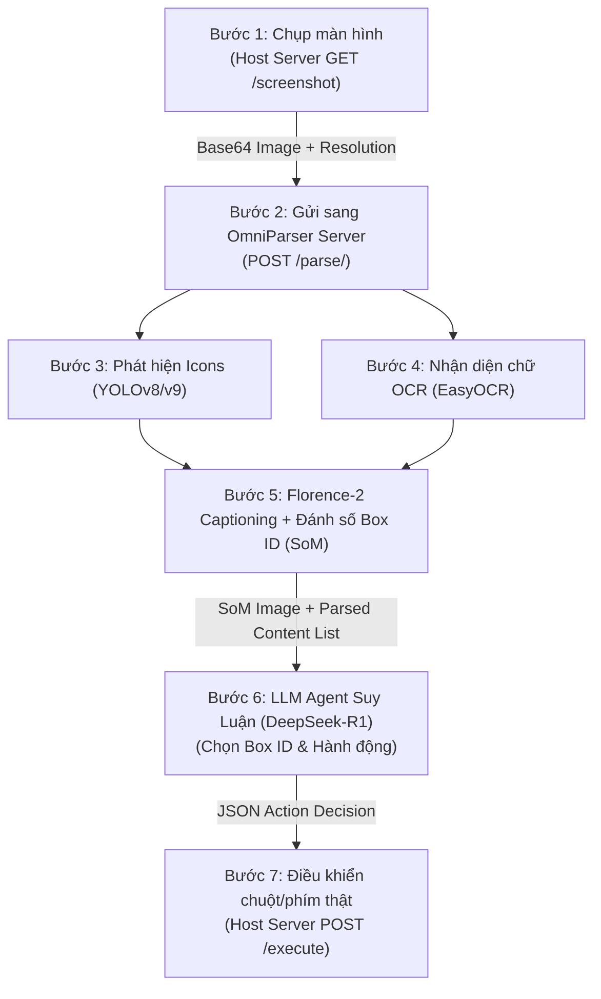

# 📊 Hệ Thống Data Schema Từng Bước Của Pipeline OmniParser & OmniTool

Thư mục này tài liệu hóa chi tiết **chuẩn dữ liệu (Input / Output Schema)** qua từng bước trong toàn bộ quy trình từ lúc chụp ảnh màn hình, nhận diện giao diện UI qua thị giác máy tính (Computer Vision), gửi sang LLM (DeepSeek-R1 / GPT-4o) suy luận, đến khi dispatch lệnh điều khiển chuột/phím thật trên hệ điều hành.

---

## 🧭 Tổng Quan Kiến Trúc Luồng Dữ Liệu (Pipeline Flow)



---

## 📑 Chi Tiết Chuẩn Dữ Liệu Từng Bước (Steps 1 – 7)

### 🔹 Bước 1: Chụp Màn Hình & Xác Định Kích Thước (Screen Capture)
* **Thành phần thực hiện:** Host Server (`omnitool/linux_host_server.py` hoặc `windows_host_server.py`)
* **Endpoint:** `GET /screenshot`
* **Mô tả:** Chụp lại toàn bộ khung hình màn hình desktop vật lý và mã hóa thành chuỗi Base64 PNG.

#### 1. Input:
* HTTP GET request (không kèm payload).

#### 2. Output Schema:
* **Schema file:** [`step1_screen_capture.schema.json`](./schemas/step1_screen_capture.schema.json)
* **Example file:** [`step1_screen_capture.example.json`](./examples/step1_screen_capture.example.json)

```json
{
  "status": "success",
  "width": 1920,
  "height": 1080,
  "scale_factor": 1.0,
  "screenshot_uuid": "e4b29c11-7362-4b77-8fa2-03915f79a9d2",
  "base64_image": "iVBORw0KGgoAAAANSUhEUgAAB4AAAAQ4CAYAAABv2i9vAAA...[TRUNCATED_BASE64_PNG]",
  "timestamp": 1728639100.125
}
```

---

### 🔹 Bước 2: Gửi Yêu Cầu Phân Tích Giao Diện Đến OmniParser
* **Thành phần gửi:** Gradio Agent (`omnitool/gradio/agent/llm_utils/omniparserclient.py`)
* **Thành phần nhận:** OmniParser Server (`omnitool/omniparserserver/omniparserserver.py`)
* **Endpoint:** `POST /parse/`

#### 1. Input Schema:
* **Schema file:** [`step2_omniparser_request.schema.json`](./schemas/step2_omniparser_request.schema.json)
* **Example file:** [`step2_omniparser_request.example.json`](./examples/step2_omniparser_request.example.json)

```json
{
  "base64_image": "iVBORw0KGgoAAAANSUhEUgAAB4AAAAQ4CAYAAABv2i9vAAA...[RAW_SCREENSHOT_BASE64]"
}
```

---

### 🔹 Bước 3: Phát Hiện Tọa Độ Biểu Tượng & Nút Bấm (YOLO Detection)
* **Thành phần thực hiện:** `util/utils.py:get_yolo_model` (mô hình `icon_detect_v3`)
* **Mô tả:** Chạy mạng nơ-ron tích chập YOLOv8/v9 tìm kiếm các vùng icon, ô input, button trên ảnh.

#### 1. Input:
* Mảng ảnh RGB `numpy.ndarray` kích thước $(H, W, 3)$ cùng ngưỡng phát hiện `BOX_TRESHOLD` ($0.05$ trên CUDA, $0.15$ trên CPU).

#### 2. Output Data Structure:
* **Schema file:** [`step3_yolo_detections.schema.json`](./schemas/step3_yolo_detections.schema.json)
* **Example file:** [`step3_yolo_detections.example.json`](./examples/step3_yolo_detections.example.json)

```json
{
  "model_version": "microsoft/OmniParser-v2.0-yolov8x",
  "box_threshold": 0.05,
  "total_detected": 4,
  "detections": [
    {
      "bbox_normalized": [0.354, 0.021, 0.621, 0.058],
      "confidence": 0.92,
      "class_id": 0,
      "label": "icon"
    },
    {
      "bbox_normalized": [0.625, 0.021, 0.655, 0.058],
      "confidence": 0.88,
      "class_id": 0,
      "label": "icon"
    }
  ]
}
```

---

### 🔹 Bước 4: Trích Xuất Văn Bản Giao Diện (OCR Text Detection)
* **Thành phần thực hiện:** `util/utils.py:check_ocr_box` (sử dụng thư viện `easyocr` hoặc `PaddleOCR`)
* **Mô tả:** Đọc toàn bộ các đoạn văn bản hiển thị trên màn hình kèm tọa độ bounding box.

#### 1. Input:
* Ảnh PIL Image RGB và tham số lọc độ tự tin `text_threshold: 0.8`.

#### 2. Output Data Structure:
* **Schema file:** [`step4_ocr_results.schema.json`](./schemas/step4_ocr_results.schema.json)
* **Example file:** [`step4_ocr_results.example.json`](./examples/step4_ocr_results.example.json)

```json
{
  "engine": "easyocr",
  "text_threshold": 0.8,
  "extracted_texts": [
    {
      "text": "Search",
      "bbox_normalized": [0.380, 0.026, 0.435, 0.052],
      "confidence": 0.97
    },
    {
      "text": "DeepMind Robotics",
      "bbox_normalized": [0.120, 0.150, 0.285, 0.180],
      "confidence": 0.94
    }
  ]
}
```

---

### 🔹 Bước 5: Tạo Nhãn Ngữ Nghĩa & Ảnh Gắn Nhãn Set-of-Mark (SoM)
* **Thành phần thực hiện:** `Florence-2` (`icon_caption_florence`) + `util/box_annotator.py`
* **Mô tả:**
  1. Loại bỏ các box trùng lặp (Non-Maximum Suppression với IoU > 0.7).
  2. Florence-2 sinh mô tả ngữ nghĩa cho từng icon (ví dụ: *"search magnifying glass"*, *"play button"*).
  3. Vẽ viền hộp màu phân biệt và in số hiệu `[0]`, `[1]`, `[2]`, ... lên ảnh.

#### 1. Output Schema (Trả về từ `/parse/`):
* **Schema file:** [`step5_omniparser_response.schema.json`](./schemas/step5_omniparser_response.schema.json)
* **Example file:** [`step5_omniparser_response.example.json`](./examples/step5_omniparser_response.example.json)

```json
{
  "som_image_base64": "iVBORw0KGgoAAAANSUhEUgAAB4AAAAQ4CAYAAABv2i9vAAA...[TRUNCATED_SOM_ANNOTATED_BASE64]",
  "parsed_content_list": [
    {
      "type": "text",
      "bbox": [0.026, 0.380, 0.052, 0.435],
      "interactivity": false,
      "content": "Search",
      "source": "box_ocr_content_ocr"
    },
    {
      "type": "icon",
      "bbox": [0.021, 0.354, 0.058, 0.621],
      "interactivity": true,
      "content": "YouTube search input box with placeholder Search",
      "source": "box_yolo_content_florence"
    },
    {
      "type": "icon",
      "bbox": [0.021, 0.625, 0.058, 0.655],
      "interactivity": true,
      "content": "magnifying glass search button icon",
      "source": "box_yolo_content_florence"
    }
  ],
  "latency": 1.482
}
```

---

### 🔹 Bước 6: Suy Luận & Ra Quyết Định Hành Động (Multimodal LLM Agent)
* **Thành phần thực hiện:** `omnitool/gradio/agent/vlm_agent.py` kết nối DeepSeek-R1 (`deepseek-r1-distill-llama-70b` qua Groq) hoặc GPT-4o.
* **Mô tả:** Mô hình nhận ảnh SoM + danh sách các ID phần tử giao diện + mục tiêu của người dùng (*"Click vào thanh tìm kiếm trên màn hình, gõ 'DeepMind Robotics' và nhấn Enter"*), sau đó suy luận và xuất kết quả hành động.

#### 1. Input Prompt Format:
```text
System: You are using a Windows/Linux device. Here is the list of detected bounding boxes by IDs:
Box ID 0: text 'Search'
Box ID 1: icon 'YouTube search input box with placeholder Search'
Box ID 2: icon 'magnifying glass search button icon'

User: Click vào thanh tìm kiếm trên màn hình, gõ 'DeepMind Robotics' và nhấn Enter.
```

#### 2. Output Schema:
* **Schema file:** [`step6_llm_agent_decision.schema.json`](./schemas/step6_llm_agent_decision.schema.json)
* **Example file:** [`step6_llm_agent_decision.example.json`](./examples/step6_llm_agent_decision.example.json)

```json
{
  "Reasoning": "The current screen shows YouTube homepage. To complete the user instruction 'Click vào thanh tìm kiếm trên màn hình, gõ DeepMind Robotics và nhấn Enter', I first need to click on the YouTube search input bar (Box ID 1) to focus cursor.",
  "Next Action": "left_click",
  "Box ID": 1
}
```

---

### 🔹 Bước 7: Thực Thi Lệnh Điều Khiển Phần Cứng Trên Hệ Điều Hành
* **Thành phần gửi:** Gradio Executor (`omnitool/gradio/executor/executor.py`)
* **Thành phần nhận:** Host Server (`omnitool/linux_host_server.py`)
* **Endpoint:** `POST /execute`
* **Mô tả:** Tọa độ tương đối $[x, y]$ của Box ID được quy đổi thành tọa độ pixel thực tế trên màn hình vật lý:
  $$\text{pixel\_x} = \text{center\_x} \times \text{screen\_width}$$
  $$\text{pixel\_y} = \text{center\_y} \times \text{screen\_height}$$
  Server gọi `pyautogui.click()` hoặc `pyautogui.write()` điều khiển chuột và bàn phím máy tính.

#### 1. Input Schema:
* **Schema file:** [`step7_host_action_execution.schema.json`](./schemas/step7_host_action_execution.schema.json)
* **Example file:** [`step7_host_action_execution.example.json`](./examples/step7_host_action_execution.example.json)

```json
{
  "action": "mouse_click",
  "point": [936, 42],
  "text": null,
  "key": null,
  "clicks": 1
}
```

#### 2. Output:
```json
{
  "status": "success",
  "action": "mouse_click",
  "point": [936, 42],
  "timestamp": 1728639102.512
}
```

---

## 🗂️ Danh Mục Tập Tin Trong Thư Mục `data_schema/`

* [`README.md`](./README.md): Tài liệu hướng dẫn chuẩn data schema từng bước (file này).
* [`schemas/`](./schemas/): Chứa các tệp JSON Schema chuẩn RFC Draft-07 phục vụ validate dữ liệu tự động.
* [`examples/`](./examples/): Chứa các ví dụ JSON thực tế từ luồng tìm kiếm YouTube / Google.
* [`artifacts/`](./artifacts/): Chứa các ảnh minh chứng gốc (`youtube_screen.png`, `google_screen.png`).
* [`generate_schema_docs.py`](./generate_schema_docs.py): Script tái tạo toàn bộ tệp JSON schema và example.

